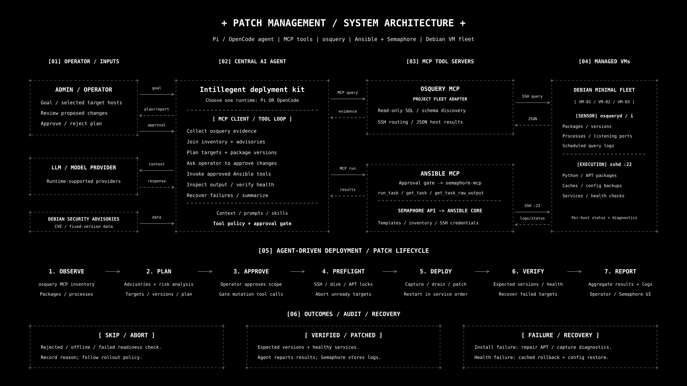

# Patch Management Agent

AI-assisted patch management for Debian fleets: inventory, security update prioritization, human approval, and canary rollout.

ESTIN — Conduite de projet, 2026–2027. Supervisors: Pr. SEBAA Abderrazak and Dr. MANSOUR Abdelaziz.

For any addition, fix, or modification, create your own branch and open a PR to `main`. Merge when checks pass and conflicts are resolved, or ask a maintainer to merge. No direct pushes to `main`.

For more details, check the [details file](detailes.md).

[Setup](SETUP.md) · [Team plan](plan.md)

