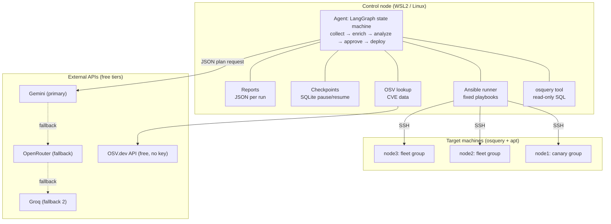
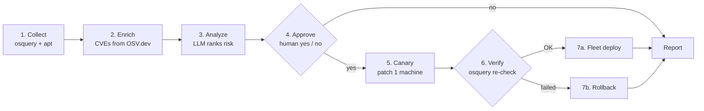
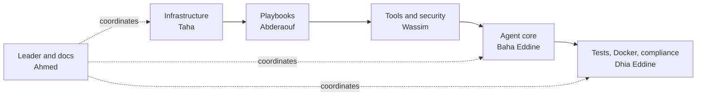

# AI Patch Agent

> An AI agent that checks every machine in a fleet for updates, ranks them by real security risk, asks a human for approval, and deploys them safely with a canary rollout and automatic rollback.

**Course:** Conduite de projet, 2nd year CS, ESTIN (École Supérieure en Sciences et Technologies de l'Informatique et du Numérique)
**Academic year:** 2026-2027
**Supervisors:** Pr. SEBAA Abderrazak, Dr. MANSOUR Abdelaziz
**Category:** Cybersecurity agent (Patch Management), designed to be integrated into a platform for SMEs (PME)

---

## Table of contents

1. [Project in one minute](#1-project-in-one-minute)
2. [Context and problem](#2-context-and-problem)
3. [Goals](#3-goals)
4. [Core design principle](#4-core-design-principle)
5. [Architecture](#5-architecture)
6. [How a run works (workflow)](#6-how-a-run-works-workflow)
7. [Technology stack](#7-technology-stack)
8. [Planned repository structure](#8-planned-repository-structure)
9. [The five Ansible playbooks](#9-the-five-ansible-playbooks)
10. [Agent modules](#10-agent-modules)
11. [Safety rules](#11-safety-rules)
12. [Lab environment](#12-lab-environment)
13. [Configuration](#13-configuration)
14. [Usage (CLI)](#14-usage-cli)
15. [Team and responsibilities](#15-team-and-responsibilities)
16. [Methodology and Git workflow](#16-methodology-and-git-workflow)
17. [Roadmap and planning](#17-roadmap-and-planning)
18. [Deliverables](#18-deliverables)
19. [Risk register](#19-risk-register)
20. [Analysis: QQOQCP, SWOT, SMART](#20-analysis-qqoqcp-swot-smart)
21. [Integration contract and compliance](#21-integration-contract-and-compliance)
22. [Future ideas](#22-future-ideas)
23. [Troubleshooting](#23-troubleshooting)
24. [Glossary](#24-glossary)

---

## 1. Project in one minute

Every piece of software (OS, browser, utilities, office suite) receives updates. Some fix simple bugs, others close **security vulnerabilities** that an attacker can exploit as long as the software is outdated. An administrator cannot manually check hundreds of machines to know which ones need which update, and which updates are urgent.

**Our agent automates the whole cycle:**

1. **Collect** the inventory and the available updates on every machine.
2. **Enrich** the updates with known vulnerabilities (CVEs).
3. **Analyze** the risk with an LLM, which outputs a prioritized patch plan.
4. **Ask a human** to approve or reject the plan.
5. **Deploy to a canary machine first**, then verify the result.
6. **Deploy to the rest of the fleet** if the canary is healthy, or **roll back** if it is not.
7. **Write a timestamped JSON report** for every run.

In short: *"A centralized agent that inventories machines, detects vulnerable software and missing patches, prioritizes risks, and deploys fixes remotely, with a human making the final decision."*

---

## 2. Context and problem

### Context

This project belongs to the *Conduite de projet* module. Each team develops one agent meant to be integrated into a platform offered to SMEs, following an **integration contract**, **developer instructions** and a **calendar of deliverables**. Our agent covers the **security of information systems**.

### Problems we address

- Machines stay unpatched for weeks because nobody has visibility on what is installed and what is available.
- Administrators cannot tell which updates are urgent (fixing exploited vulnerabilities) and which can wait.
- A mass, uncontrolled deployment can break production services. There is often no prior test and no rollback plan.
- There is no traceability: who patched what, when, and with what result.

### Why it matters for SMEs

A company with 20 to 200+ machines usually has no dedicated security team. Manual patching is slow and easy to forget, and commercial tools (WSUS, Intune, ManageEngine...) are expensive or heavy. Our agent brings automation at **zero cost**, and keeps a human in the loop for risky decisions. On the target machines it only needs **osquery and SSH**.

### Why we chose this agent

- Concrete and topical: patching is one of the most effective and most neglected security measures.
- It combines skills we want to master: system administration, automation (Ansible), monitoring (osquery), generative AI and security.
- It is feasible with 100% free / open-source tools, as required by the module.
- Its architecture (separate steps, validation, approval) splits naturally into responsibilities for a team of six.

### Manual management vs. our agent

| Criterion | Manual management | Our agent |
|---|---|---|
| Fleet visibility | Partial, depends on the admin | Complete, via osquery |
| Prioritization | Gut feeling | Based on CVEs and LLM analysis |
| Risk of outage | High with direct deployment | Reduced: canary, stop at first failure |
| Traceability | Weak or none | One report per run |
| Cost | High working time | Free tools, minimal time |

---

## 3. Goals

### Main goals

- Automate the full cycle: collection, CVE enrichment, analysis, approval, canary deployment, verification, fleet deployment or rollback, report.
- Prioritize updates by **real security risk** (associated CVEs) instead of a simple list.
- Guarantee a **safe deployment**: mandatory human approval, canary machine, stop at the first failure.

### Expected deliverable results

- A working agent demonstrated on a lab of **3 virtual machines** (1 canary, 2 fleet).
- An agent **compliant with the integration contract**, validated by conformity tests and packaged with **Docker**.
- A **JSON report generated at every run**, and the code published on GitHub with documentation.
- An agent ready to be submitted and then integrated into the platform.

### Secondary goals

- Multiple LLM providers with automatic fallback when a quota is exceeded or a response is invalid.
- Resume after interruption thanks to checkpoints (SQLite).
- Plain-English questions about the fleet state (bonus), limited to read-only `SELECT` queries.
- Scheduled periodic checks.

---

## 4. Core design principle

> **The LLM decides, but it never executes.**

The LLM only returns a **JSON plan**. Our Python code **validates** that plan and runs **fixed, pre-written Ansible playbooks**. This strongly limits the risks of a language model's mistakes and works reliably even with free models that sometimes misbehave.

Consequences:

- The LLM cannot run shell commands, arbitrary SQL, or invent package names.
- Package names are filtered against the real list of available updates and checked by regex.
- Hostnames and IPs are **never** sent to the LLM (only package names, versions and a host count).

---

## 5. Architecture

The agent runs on **one control node** (a PC with WSL2/Linux, or a small VM). It reaches every other machine over **SSH using Ansible**. Nothing extra runs on the targets except osquery.



### What each component does

| Component | Role |
|---|---|
| **osquery** | Exposes the OS as SQL tables (`deb_packages`, `os_version`...). Used to see what is installed and to **verify** patches. |
| **apt (via Ansible)** | osquery knows what is installed, not what is *available*. `apt list --upgradable` fills that gap. |
| **OSV.dev** | Free vulnerability database. Tells the agent which pending updates fix real CVEs. |
| **Gemini / OpenRouter / Groq** | Reads the package + CVE list and returns a prioritized patch plan as JSON. |
| **LangGraph** | Runs the steps as a state machine; can pause for human approval and resume later. |
| **Ansible** | The **only** thing that changes machines. Runs pre-written playbooks: check, patch, rollback. |

---

## 6. How a run works (workflow)



| Step | What happens |
|---|---|
| **Collect** | `apt list --upgradable` through Ansible on all hosts. Results are aggregated per package (no hostnames). |
| **Enrich** | Each candidate package is looked up on OSV.dev to attach known CVEs. |
| **Analyze** | The LLM receives the aggregated list and returns a JSON plan: `priority` (critical/high/medium/low) and `action` (patch/defer) per package. Kernel and major-version upgrades are deferred unless they fix a critical/high CVE. |
| **Approve** | The graph calls `interrupt()`, saves its state to SQLite and stops. The human resumes later with `yes` or `no`. Nothing changes before approval. |
| **Canary** | The `patch.yml` playbook runs on the canary group only. |
| **Verify** | osquery re-checks the installed versions against the expected ones. |
| **Fleet or rollback** | If the canary is healthy, the fleet is patched (one machine at a time, stop on first failure). Otherwise the canary is rolled back. |
| **Report** | A timestamped JSON report is written to `reports/`. |

### Example plan produced by the LLM

```json
{
  "summary": "2 security fixes to apply now, 1 kernel update deferred.",
  "items": [
    {"package": "openssl", "priority": "high", "action": "patch", "reason": "Fixes a high-severity CVE"},
    {"package": "curl", "priority": "medium", "action": "patch", "reason": "Security update"},
    {"package": "linux-generic", "priority": "low", "action": "defer", "reason": "Kernel update needs reboot; no critical CVE"}
  ],
  "provider": "gemini"
}
```

---

## 7. Technology stack

Everything is **free or open source ($0)**.

| Need | Tool | Cost |
|---|---|---|
| LLM (primary) | Google Gemini API via AI Studio | Free tier, no card |
| LLM (fallback) | OpenRouter `:free` models, Groq | Free tier, rate-limited |
| Inventory and verification | osquery | Open source |
| Deployment | Ansible (+ `ansible.posix` collection) | Open source |
| Agent framework | LangGraph (+ SQLite checkpointer) | Open source |
| CVE data | OSV.dev API | Free, no key |
| Lab machines | VirtualBox + Vagrant | Open source |
| Control node on Windows | WSL2 (Ubuntu) | Free |
| Language and libs | Python 3, `openai`, `requests`, `python-dotenv` | Open source |
| Packaging | Docker | Open source |
| Collaboration | Git / GitHub, GitHub Projects | Free |

> Free-tier limits and model names change often. The model name is read from `.env`, so switching models never requires editing Python.

---

## 8. Planned repository structure

```text
ai-patch-agent/
├── README.md
├── .env.example               # template only, never commit the real .env
├── .gitignore                 # must contain .env from the very first commit
├── inventory.ini              # canary + fleet groups
├── Vagrantfile                # 3 Ubuntu 22.04 VMs
├── requirements.txt
├── Dockerfile
├── playbooks/
│   ├── install_osquery.yml
│   ├── osquery_query.yml
│   ├── check_updates.yml
│   ├── patch.yml
│   └── rollback.yml
├── agent/
│   ├── llm.py                 # Gemini + OpenRouter/Groq fallback, JSON validation
│   ├── tools.py               # osquery, apt, OSV, deploy, rollback + input validation
│   ├── graph.py               # LangGraph workflow
│   ├── main.py                # CLI: run / approve
│   └── ask.py                 # bonus: plain-English questions
├── api/                       # skeleton exposing the agent per the integration contract
├── tests/                     # tools, contract conformity, failure scenarios
├── docs/                      # architecture, roles, planning, risks, meeting minutes
├── data/                      # checkpoints.db (auto-created, git-ignored)
└── reports/                   # one JSON report per run (git-ignored)
```

> This is the target layout. Files will be added step by step during the project.

---

## 9. The five Ansible playbooks

These five playbooks are the **only actions the agent can take** on machines.

| Playbook | Purpose | Notes |
|---|---|---|
| `install_osquery.yml` | Installs osquery (signing key, apt repo, package) | Run once per machine |
| `osquery_query.yml` | Runs a single validated osquery `SELECT` | Uses `argv`, never a shell |
| `check_updates.yml` | Refreshes apt cache and lists upgradable packages | Read-only |
| `patch.yml` | Upgrades the selected packages only (`only_upgrade`) | `serial: 1`, `max_fail_percentage: 0`, reports if a reboot is required |
| `rollback.yml` | Downgrades packages to pinned previous versions | Works only if the old version is still available in the repo or cache |

> For real safety, rely on **VM snapshots** in the lab and **filesystem snapshots** in production, not only on `apt` downgrades.

---

## 10. Agent modules

| Module | Responsibility |
|---|---|
| `llm.py` | One OpenAI-compatible client for all providers (Gemini, OpenRouter, Groq). Tries providers in order, extracts and validates the JSON (accepts raw JSON or JSON inside code fences). Raises an error only if all providers fail. |
| `tools.py` | Ansible plumbing (`_run_playbook`), read-only tools (`validate_sql`, `run_osquery`, `get_upgradable`, `osv_lookup` with cache) and write tools (`deploy`, `rollback`) that are only called after approval. Every input is validated first. |
| `graph.py` | LangGraph state machine with nodes `collect`, `enrich`, `analyze`, `approve`, `canary`, `fleet`, `rollback`, `report` and conditional edges. |
| `main.py` | CLI: `run` starts a pipeline and pauses at approval; `approve <thread_id> yes\|no` resumes it. |
| `ask.py` | Bonus: the LLM translates a question into one osquery `SELECT`; the validator guarantees it is read-only and uses allowed tables only. |

---

## 11. Safety rules

These rules are **not optional**.

| Rule | How it is enforced |
|---|---|
| The LLM never runs commands | It only returns JSON; Python picks from fixed playbooks. |
| No invented packages | Plan items are filtered against the real candidate list. |
| No injection | Package names and pins checked by regex; SQL limited to a single `SELECT` on a whitelist of tables; `argv` used instead of a shell. |
| Human in the loop | `interrupt()`: nothing changes until a human approves. |
| Limited blast radius | Canary first, `serial: 1`, `max_fail_percentage: 0`. |
| Verification | osquery confirms the new versions before the fleet is touched. |
| Recovery | Automatic rollback attempt + VM snapshots. |
| No data leak | Hostnames and IPs never go to the LLM. |
| Secrets | `.env` is git-ignored from the first commit; each member uses a personal API key; regenerate immediately if leaked. |

**Allowed osquery tables:** `deb_packages`, `os_version`, `system_info`, `uptime`, `kernel_info`, `listening_ports`, `processes`, `users`.

> Only run this against machines you own or are allowed to manage. Test in the Vagrant lab until you trust it.

---

## 12. Lab environment

- **Control node:** WSL2 (Ubuntu) on Windows, or any Linux. Ansible does not run natively on Windows.
- **Targets:** 3 Ubuntu 22.04 VMs (`ubuntu/jammy64`) on a private network, 1 GB RAM each, created with **VirtualBox + Vagrant**.

| VM | IP | Group |
|---|---|---|
| node1 | 192.168.56.11 | `canary` |
| node2 | 192.168.56.12 | `fleet` |
| node3 | 192.168.56.13 | `fleet` |

- **Hardware:** a PC with virtualization enabled and at least 8 GB RAM is recommended. With less, work with 2 VMs and share the lab between the most powerful PCs.
- **Golden rule:** take a snapshot before every experiment (`vagrant snapshot save clean`). `vagrant snapshot restore clean` undoes anything the agent does in seconds.

---

## 13. Configuration

Copy `.env.example` to `.env` and fill in your own keys. **Never commit `.env`.**

| Variable | Description |
|---|---|
| `GEMINI_API_KEY` | Free key from Google AI Studio |
| `GEMINI_MODEL` | Current Gemini model name (copy it from AI Studio) |
| `OPENROUTER_API_KEY` / `OPENROUTER_MODEL` | Optional fallback 1 (leave empty to skip) |
| `GROQ_API_KEY` / `GROQ_MODEL` | Optional fallback 2 (leave empty to skip) |
| `OSV_ECOSYSTEM` | OSV ecosystem matching the target OS, e.g. `Ubuntu:22.04:LTS` |

---

## 14. Usage (CLI)

```bash
# 1. Start a run: collect → enrich → analyze → pause for approval
python agent/main.py run

# 2. Review the plan, then resume with your decision
python agent/main.py approve <thread_id> yes    # or: no

# Bonus: ask the fleet a question in plain English (read-only)
python agent/ask.py "list processes listening on port 22"
```

**Scheduling (optional):** run the check every night, the agent prepares a plan and waits, and a human approves in the morning.

```cron
0 3 * * * cd ~/patch-agent && .venv/bin/python agent/main.py run >> logs/agent.log 2>&1
```

---

## 15. Team and responsibilities

Team of six. **Every member also reviews at least one other member's module** to avoid depending on a single person. Roles can be adjusted after the first team meeting.

| Member | Role | Main responsibilities |
|---|---|---|
| **BOULOUH Ahmed Ouassim** | Team leader, documentation, GitHub | Coordination, planning, meetings and minutes, writing and assembling deliverables, GitHub repo, reading the integration contract, CLI `main.py`, Elearn submission, quality control and global view of progress |
| **BELALOUI Taha Abderrahmane** | Infrastructure / lab | WSL2, Vagrantfile, VMs and snapshots, `inventory.ini`, osquery installation, SSH connectivity |
| **BECHICHE Mohamed Abderaouf** | Ansible playbooks | `check_updates`, `patch` (serial, stop at first failure), `rollback`, `osquery_query`, testing playbooks on the VMs |
| **GAHTAR Mohamed Baha Eddine** | Agent core | `llm.py` (providers and fallback), `graph.py` (LangGraph), prompts, JSON plan, checkpoints, approval step |
| **MEFTAH Wassim Abdallah** | Tools and security | `tools.py`: SQL and package-name validation, `osv_lookup`, deploy/rollback, JSON report generation, secrets management |
| **LAGHROUR Mohamed Dhia Eddine** | Tests, Docker, compliance | Contract conformity tests, failure scenarios, Dockerfile, API skeleton, quality follow-up |

### Dependencies between roles



---

## 16. Methodology and Git workflow

**Hybrid agile.** A light initial framing (the orientation document), then **weekly sprints**, each ending with an internal demo and a review meeting. Administrative deliverables (charter, plan, report) follow a waterfall-style rhythm imposed by the module calendar.

**Why not pure waterfall?** The project is large and multi-part (infra, playbooks, tools, LLM, workflow, tests). Waterfall would make us wait for each phase to finish before seeing results. Iterating lets us build a working MVP early and add features after.

**Team rituals**

- Weekly team meeting, with minutes (PV) written by the team leader.
- Task board on **GitHub Projects**.
- **One Git branch per feature**, reviewed through a **pull request** before merging into `main`.
- Cross-review: each member reviews at least one other module.

**Suggested conventions**

- Branch names: `feature/<short-name>`, `fix/<short-name>`, `docs/<short-name>`.
- Commit messages: short, imperative, in English.
- Never push directly to `main`.
- Never commit secrets (`.env`, API keys, SSH private keys).

---

## 17. Roadmap and planning

### Technical steps

| # | Step | Content |
|---|---|---|
| 1 | Lab | WSL2 + Ansible, Vagrantfile (3 VMs), "clean" snapshot, `inventory.ini` (canary and fleet groups), `ansible ping` test |
| 2 | Playbooks and osquery | `install_osquery`, `osquery_query`, `check_updates`, `patch`, `rollback` |
| 3 | Agent tools | `tools.py`: SQL validation, `run_osquery`, `get_upgradable`, `osv_lookup`, `deploy`, `rollback` |
| 4 | LLM client | `llm.py`: Gemini + OpenRouter/Groq fallback, JSON extraction and validation |
| 5 | Workflow | `graph.py` (LangGraph): collect → enrich → analyze → approve → canary → verify → fleet or rollback, SQLite checkpoints |
| 6 | API skeleton and CLI | Agent exposure per the integration contract, business logic, `main.py` |
| 7 | Docker packaging | Dockerfile and reproducible execution |
| 8 | Conformity tests | Tools, contract, failure scenarios (failed patch, rollback) |
| 9 | Submission | Code, report and presentation |

### Project phases

| Phase | Activities | Milestone | Owners |
|---|---|---|---|
| 0: Framing | Agent choice, roles, orientation document | Deliverable 1 | Whole team |
| 1: Lab | WSL2, Vagrant, VMs, inventory, osquery, base playbooks | Lab operational | Infra, Playbooks |
| 2: Tools and LLM | `tools.py`, `osv_lookup`, `llm.py`, validations | Tools tested | Tools, Core |
| 3: Workflow | `graph.py`, approval, checkpoints, canary, verification, rollback | End-to-end agent | Core, Playbooks |
| 4: Compliance and packaging | API skeleton, Docker, conformity tests | Contract-compliant version | Tests, Leader |
| 5: Finalization | Report, documentation, GitHub, presentation | Submission | Whole team |

> Exact dates will be set once the consolidated module calendar is received and validated at the first team meeting.

### MVP vs. later

- **MVP (must have):** inventory, CVE enrichment, LLM plan, human approval, canary deployment, verification, rollback, JSON reports, 3-VM demo.
- **Important:** Docker packaging, contract conformity tests, checkpoints and resume.
- **Bonus:** plain-English questions (`ask.py`), scheduling, notifications, dashboard.

### Target demo scenario

1. Show the 3 VMs with pending updates.
2. Run the agent and show the collected inventory and CVEs.
3. Show the LLM's prioritized plan.
4. Approve the plan.
5. Watch the canary get patched and verified.
6. Watch the fleet get patched.
7. Simulate a failure and show the rollback.
8. Open the generated JSON report.

---

## 18. Deliverables

| # | Deliverable | File naming | Deadline |
|---|---|---|---|
| 1 | Orientation document | `Conduite_orientation_equipe.doc` | T1, October 2026 (submitted on Elearn by the team leader) |
| 2 | Project charter | To confirm per module naming | Per calendar |
| 3 | Meeting minutes (PV) | To confirm per module naming | Per calendar |
| 4 | Project plan | To confirm per module naming | Per calendar |
| 5 | Report + GitHub code | To confirm per module naming | Per calendar |
| 6 | Follow-up and assessment | To confirm per module naming | Per calendar |
| 7 | Final presentation | To confirm per module naming | Per calendar |

The cover page of each deliverable contains the project title, the team members and the elements requested in that deliverable.

**Reference documents from the supervisors** (to read fully and keep in `docs/`):

- `AGENT_INTEGRATION_CONTRACT.doc`
- `DEVELOPER_INSTRUCTIONS.doc`
- `INTER_AGENT_DATA_CONTRACT.doc` (only if the agent falls under the business-automation track, to confirm with the supervisors)

---

## 19. Risk register

| # | Risk | Category | Impact | Mitigation |
|---|---|---|---|---|
| R1 | Free LLM quotas or provider unavailable | Technical | Medium | Fallback Gemini → OpenRouter → Groq; model name in `.env`; OSV cache; tests on simulated data |
| R2 | Invalid or dangerous LLM response (bad JSON, non-existent package) | Technical / security | High | JSON extraction and validation; packages limited to the real update list; regex checks; no direct execution of the LLM output |
| R3 | A patch breaks a machine or service | Technical | High | "clean" snapshot, canary, stop at first failure (`max_fail_percentage: 0`), osquery verification, rollback playbook |
| R4 | Non-compliance with the integration contract | Compliance | High | Read the contract from day one, automated conformity tests, leader review at each milestone |
| R5 | Insufficient hardware (RAM, virtualization) | Technical | Medium | 1 GB per VM; work with 2 VMs if needed; share the lab between the most powerful PCs |
| R6 | Overload or poor coordination | Organizational | Medium | Weekly meeting, task board, branches and pull requests, cross-reviewers |
| R7 | API keys or secrets leaked on GitHub | Security | High | `.env` in `.gitignore` from the first commit; personal key per member; immediate regeneration if leaked |
| R8 | External API unavailable (OSV, NVD) | Technical | Medium | Local cache and simulated data fallback |

---

## 20. Analysis: QQOQCP, SWOT, SMART

### QQOQCP

| Question | Answer |
|---|---|
| **What?** | A centralized patch-management agent that inventories machines (osquery), detects vulnerable software and missing patches, prioritizes risks, and deploys fixes remotely (Ansible). |
| **Who?** | Targets: SMEs, system administrators and security officers. Actors: our team of 6 students, the supervisors (client/sponsor), the IT operators using the tool. |
| **When?** | Weekly sprints over roughly 5 to 6 weeks, following the module calendar. |
| **Where?** | The internal network of an SME (Linux machines first). For the demo: a lab of virtual machines (VirtualBox/Vagrant) plus a control node. |
| **How?** | Hybrid agile, stack: osquery, Ansible, LangGraph, LLM APIs, Python, Docker, Git. Dry-run and VM tests before anything real. |
| **Why?** | Reduce the risk of cyberattack caused by outdated software, save administrator time, ensure traceability, and gain practical cybersecurity and DevOps skills. |

### SWOT

| | Positive | Negative |
|---|---|---|
| **Internal** | **Strengths:** recognized open-source tools (no agent to build from scratch); team of 6 with clear roles; modular architecture; security built in (validation, approval, whitelists) | **Weaknesses:** limited experience with osquery, Ansible and LangGraph; short time for a wide project; only tested on VMs; dependencies between members |
| **External** | **Opportunities:** rising cyberattacks mean strong demand; SMEs lack affordable tools; free data sources (OSV, CVE); active communities; good CV project | **Threats:** a bad patch can break a machine; free-tier limits or API changes; mature professional competitors; possible flaws in our own platform (SSH access, injection); VM hardware limits |

### SMART objectives

| # | Objective |
|---|---|
| 1. Inventory | Automatically collect the inventory (OS, packages + versions) of at least 3 VMs with a success rate of at least 95%. |
| 2. Detection and prioritization | Detect outdated software on a set of reference packages and assign each a priority (critical/high/medium/low). |
| 3. Deployment | Deploy a patch via Ansible (dry-run first, then real) on at least 3 machines in under 5 minutes, with automatic result verification. |
| 4. Traceability | Produce a report for 100% of runs, including approvals, canary result, fleet result and rollback. |
| 5. Delivery | Deliver a complete MVP with an end-to-end demo, Docker packaging, JSON reports and documentation. |

---

## 21. Integration contract and compliance

The agent must be **plugged into a common SME platform**, so it must follow:

- `AGENT_INTEGRATION_CONTRACT`: how the agent is exposed and integrated into the platform.
- `DEVELOPER_INSTRUCTIONS`: rules for agent developers.

Our strategy: read both documents fully at the start, build the `api/` skeleton to match the contract, write **automated conformity tests**, and have the team leader review compliance before every milestone.

> The detailed guidelines in this README will be adjusted after a full reading of the supervisors' contract documents.

---

## 22. Future ideas

**Usability**

- Telegram or Discord bot sending the plan with Approve / Reject buttons.
- Small FastAPI + HTML dashboard showing reports and fleet status.
- Binary → source package mapping for better CVE matching (OSV indexes Ubuntu by *source* package, e.g. `libssl3` comes from `openssl`).

**Smarter agent**

- Maintenance windows per group.
- Reboot orchestration when `/var/run/reboot-required` exists.
- Drift detection against a baseline.
- Support for RHEL/Rocky (`rpm_packages`, `dnf`).
- Expose the tools as an **MCP server**.
- Risk scoring that combines CVE severity, machine exposure and machine criticality.
- Role-based access control (RBAC) and a full audit log for a multi-user platform.

**Scale**

- FleetDM to manage osquery centrally instead of over SSH.
- AWX as an Ansible web UI.

---

## 23. Troubleshooting

| Problem | Fix |
|---|---|
| All LLM providers failed | Check API keys in `.env`; you may have hit the daily free limit, so add a second provider key. |
| Model not found | Model names change. Copy the current name from AI Studio / OpenRouter into `.env`. |
| `ansible-playbook ... failed` with no JSON | Run `ansible-galaxy collection install ansible.posix` (provides the JSON callback). |
| Hosts unreachable | Run `ansible all -i inventory.ini -m ping`; check SSH key paths and that the VMs are up. |
| `osqueryi: not found` | Run `install_osquery.yml` first. |
| No CVEs ever found | Check that `OSV_ECOSYSTEM` matches your OS release; see the source-package note above. |
| Canary always fails verification | Compare the version strings from `apt list` and osquery's `deb_packages` by hand for one package. |

---

## 24. Glossary

| Term | Meaning |
|---|---|
| **Patch / correctif** | An update that fixes a bug or a security vulnerability. |
| **CVE** | A publicly referenced security vulnerability with a unique ID. |
| **Canary** | The first machine patched, used as a test before touching the rest of the fleet. |
| **Fleet** | All the other machines, patched only if the canary succeeds. |
| **Rollback** | Returning a machine to its previous package versions after a failed patch. |
| **osquery** | Tool that exposes an operating system as SQL tables. |
| **Ansible** | Automation tool that runs playbooks on remote machines over SSH. |
| **LangGraph** | Framework to run an agent as a state machine with pause/resume. |
| **OSV.dev** | Free open-source vulnerability database. |
| **Checkpoint** | A saved state of the workflow (SQLite) that allows resuming later. |
| **Dry-run** | A simulated execution (`ansible --check`) that changes nothing. |
| **PME / SME** | Small and medium-sized enterprise. |

---

